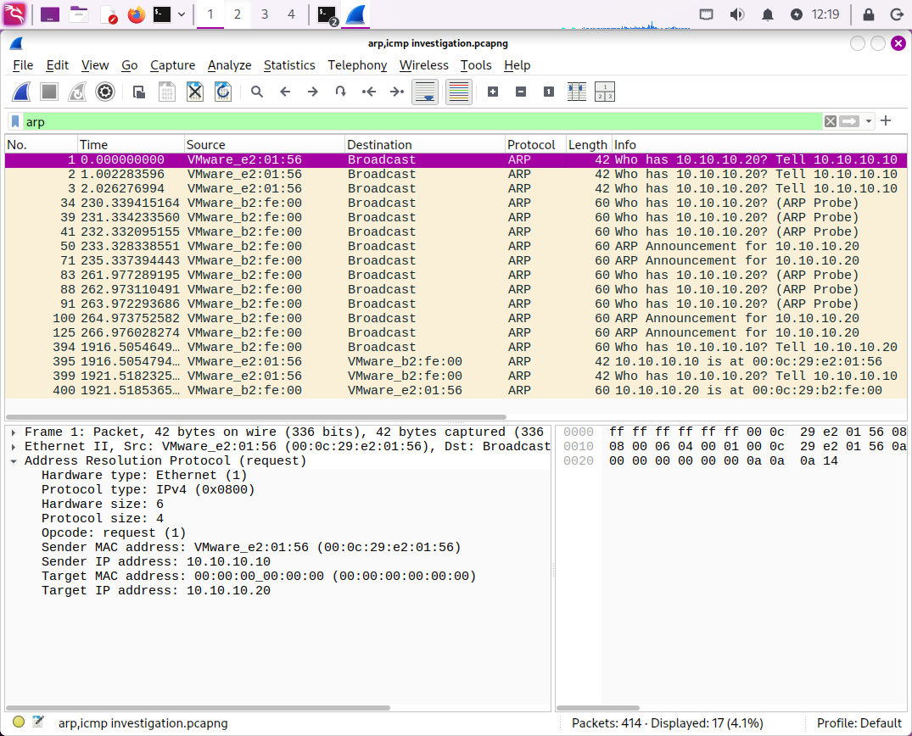
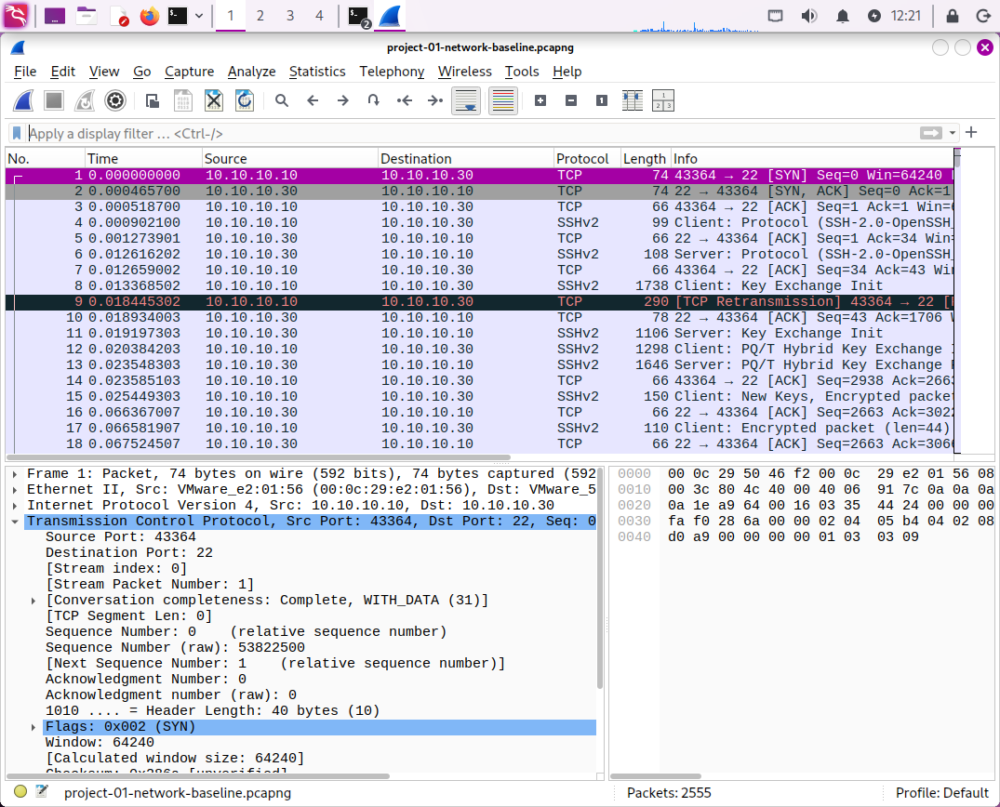

<div align="center">


\# Project 01 | Core Cyber Range Foundation


\### Enterprise Cyber Range


!\[Status](https://img.shields.io/badge/Status-Complete-success?style=for-the-badge)

!\[Category](https://img.shields.io/badge/Category-Security%20Infrastructure-blue?style=for-the-badge)

!\[Difficulty](https://img.shields.io/badge/Difficulty-Easy%20%2F%20Medium-orange?style=for-the-badge)


!\[VMware](https://img.shields.io/badge/VMware-Virtualization-607078?style=flat-square)

!\[Kali Purple](https://img.shields.io/badge/Kali-Purple-6741a5?style=flat-square)

!\[Nmap](https://img.shields.io/badge/Nmap-Reconnaissance-red?style=flat-square)

!\[Wireshark](https://img.shields.io/badge/Wireshark-Packet%20Analysis-1679A7?style=flat-square)


\[Overview](#project-overview) •

\[Architecture](#network-architecture) •

\[Implementation](#implementation) •

\[Investigation](#network-traffic-investigation) •

\[Evidence](#supporting-evidence)


\[Return to Enterprise Cyber Range](../README.md)


</div>


\---


\## Project Overview


This project establishes the foundational infrastructure for the Enterprise Cyber Range.


The environment consists of a Kali Purple security operations workstation, a Windows employee endpoint, and an Ubuntu enterprise server operating within an isolated virtual network.


The project focuses on infrastructure deployment, secure networking, asset discovery, service baselining, and network traffic analysis.


\### Project Objectives


\- Deploy a controlled enterprise laboratory environment.

\- Configure an isolated virtual network.

\- Establish predictable static IP addressing.

\- Perform network reconnaissance and service enumeration.

\- Capture and investigate network traffic.

\- Establish clean system recovery points.

\- Document infrastructure and technical findings.


\---


\## Network Architecture


```mermaid

flowchart TD

&#x20;   HOST\["VMware Host<br/>10.10.10.1"]

&#x20;   NET\["VMnet2<br/>10.10.10.0/24<br/>Host-Only Network"]


&#x20;   HOST --> NET


&#x20;   NET --> KP\["KP-SOC01<br/>10.10.10.10"]

&#x20;   NET --> WIN\["WIN11-USER01<br/>10.10.10.20"]

&#x20;   NET --> UB\["UBUNTU-SRV01<br/>10.10.10.30"]


&#x20;   KP <-->|ICMP| WIN

&#x20;   KP <-->|SSH / TCP 22| UB


&#x20;   style KP fill:#6741a5,color:#fff

&#x20;   style WIN fill:#0078d4,color:#fff

&#x20;   style UB fill:#c74618,color:#fff

```


\### Asset Inventory


| Hostname | Operating System | IP Address | Role |

| :--- | :--- | :--- | :--- |

| KP-SOC01 | Kali Purple | 10.10.10.10 | Security Operations |

| WIN11-USER01 | Windows 11 Pro | 10.10.10.20 | Employee Endpoint |

| UBUNTU-SRV01 | Ubuntu Server | 10.10.10.30 | Enterprise Server |


\### Resource Allocation


| System | vCPU | Memory | Virtual Disk |

| :--- | :---: | :---: | :---: |

| KP-SOC01 | 4 | 4 GB | 80 GB |

| WIN11-USER01 | 2 | 4 GB | 64 GB |

| UBUNTU-SRV01 | 2 | 2 GB | 40 GB |


\### Network Configuration


| Parameter | Configuration |

| :--- | :--- |

| Virtual Network | VMnet2 |

| Network Type | Host-Only |

| Subnet | 10.10.10.0/24 |

| Subnet Mask | 255.255.255.0 |

| DHCP | Disabled |

| Address Assignment | Static |

| Default Gateway | None |

| Internet Access | Disabled during lab testing |


\---


\## Implementation


| Milestone | Task | Status |

| :---: | :--- | :---: |

| 01 | Git and GitHub Repository Setup | Complete |

| 02 | Host Readiness and VMware Configuration | Complete |

| 03 | Isolated Virtual Network | Complete |

| 04 | Kali Purple Deployment | Complete |

| 05 | Windows 11 Deployment | Complete |

| 06 | Ubuntu Server Deployment | Complete |

| 07 | Static IP Address Configuration | Complete |

| 08 | Network Reconnaissance | Complete |

| 09 | Clean Baseline Snapshots | Complete |

| 10 | Asset Inventory and Documentation | Complete |

| 11 | Network Packet Investigation | Complete |

| 12 | Evidence Collection and Project Closeout | Complete |


\---


\## Network Reconnaissance


Nmap was used from KP-SOC01 to establish an initial inventory of network assets and exposed services.


\### Host Discovery


```bash

sudo nmap -n -sn 10.10.10.0/24

```


\### Service Enumeration


```bash

sudo nmap -n -sS -sV 10.10.10.20

sudo nmap -n -sS -sV 10.10.10.30

```


\### Baseline Objectives


| System | Expected Behavior |

| :--- | :--- |

| KP-SOC01 | Security analysis and network monitoring |

| WIN11-USER01 | Restricted inbound network access |

| UBUNTU-SRV01 | Authorized SSH service on TCP port 22 |


The established baseline provides a reference for identifying unexpected hosts, unauthorized services, and future network anomalies.


\---


\## Network Traffic Investigation


Wireshark was used to investigate three protocols within the cyber range.


\### Investigation 01 | ARP Address Resolution


\*\*Objective\*\*


Observe how systems discover MAC addresses before communicating across the local network.


\*\*Display Filter\*\*


```text

arp

```


\*\*Findings\*\*


\- Identified ARP broadcast requests from Kali Purple.

\- Observed address resolution involving the Windows endpoint.

\- Identified sender and target IP addresses.

\- Examined Ethernet and MAC address information.


<div align="center">



<br>

<i>Figure 1 — ARP request and response analysis.</i>

</div>


\---


\### Investigation 02 | ICMP Connectivity


\*\*Objective\*\*


Validate communication between the security workstation and the Windows endpoint.


\*\*Display Filter\*\*


```text

icmp

```


\*\*Findings\*\*


\- Observed two ICMP echo requests.

\- Confirmed two corresponding echo replies.

\- Identified ICMP Type 8 echo requests.

\- Verified communication between 10.10.10.10 and 10.10.10.20.


<div align="center">


<br>

<i>Figure 2 — Successful endpoint connectivity validation.</i>

</div>


\---


\### Investigation 03 | SSH and TCP Analysis


\*\*Objective\*\*


Analyze the establishment of an encrypted remote administration session between Kali Purple and Ubuntu Server.


\*\*Display Filter\*\*


```text

tcp.port == 22

```


\*\*TCP Session Establishment\*\*


```mermaid

sequenceDiagram

&#x20;   participant KP as Kali Purple

&#x20;   participant UB as Ubuntu Server


&#x20;   KP->>UB: TCP SYN

&#x20;   UB->>KP: TCP SYN-ACK

&#x20;   KP->>UB: TCP ACK


&#x20;   KP->>UB: SSH Protocol Negotiation

&#x20;   UB-->>KP: SSH Key Exchange

&#x20;   KP<<->>UB: Encrypted Session Traffic

```


\*\*Findings\*\*


\- Identified the TCP three-way handshake.

\- Observed SSH protocol negotiation.

\- Identified SSH key exchange traffic.

\- Confirmed encrypted application traffic.

\- Verified communication over destination TCP port 22.


<div align="center">



<br>

<i>Figure 3 — TCP handshake and SSH session analysis.</i>

</div>


\---


\## Security Controls


| Control | Implementation |

| :--- | :--- |

| Network Isolation | VMware host-only network |

| Endpoint Protection | Microsoft Defender enabled |

| Host Firewall | Windows Defender Firewall enabled |

| Address Management | Static IP addressing |

| Recovery | Clean VMware snapshots |

| Remote Administration | Encrypted SSH communication |

| Asset Visibility | Nmap reconnaissance |

| Network Visibility | Wireshark packet analysis |


\### Recovery Baseline


All three virtual machines have a clean recovery snapshot named:


`P1-CLEAN-BASELINE`


These snapshots provide recovery points for future configuration changes and controlled security testing.


\---


\## Supporting Evidence


\### Documentation


\- \[Asset Inventory](documentation/ASSET-INVENTORY.md)

\- \[Foundation Network Topology](../architecture/FOUNDATION-TOPOLOGY.md)


\### Network Reconnaissance


\- \[Host Discovery](evidence/host-discovery.txt)

\- \[Windows Service Baseline](evidence/windows-baseline.txt)

\- \[Ubuntu Service Baseline](evidence/ubuntu-baseline.txt)


\### Packet Captures


\- \[ARP and ICMP Investigation](evidence/01-arp-icmp-investigation.pcapng)

\- \[SSH Investigation](evidence/02-ssh-investigation.pcapng)


\---


\## Technical Skills Demonstrated


| Domain | Skills |

| :--- | :--- |

| Virtualization | VM deployment, resource allocation, snapshots |

| Networking | IPv4, subnetting, ARP, ICMP, TCP |

| Linux | System administration, networking, SSH |

| Windows | Endpoint configuration and host security |

| Network Security | Reconnaissance and service baselining |

| Security Analysis | Packet capture and protocol investigation |

| Documentation | Git, GitHub, architecture diagrams |


\---


\## Key Takeaways


Establishing a reliable infrastructure and network baseline is essential before introducing security monitoring and detection capabilities.


This project demonstrated how network traffic can be used to validate system behavior, identify exposed services, and establish a reference point for future security investigations.


The environment also provides a controlled foundation for testing security controls without exposing external systems to unauthorized testing.


\---


\## Project Outcome


\*\*Status: Complete\*\*


The core cyber range infrastructure has been successfully deployed, configured, documented, and tested.


Three operational virtual machines are communicating within the isolated laboratory network. Initial network reconnaissance, service baselining, and packet analysis have been completed.


The environment is prepared for enterprise network segmentation, centralized monitoring, and future security engineering projects.


\---


\## Next Project


\*\*Project 02 — Enterprise Network Security and Segmentation\*\*


The next project will introduce pfSense, network segmentation, firewall policies, routing, and controlled communication between enterprise network zones.


\---


<div align="center">


\*\*Project 01 — Core Cyber Range Foundation\*\*


\[Return to Main Repository](../README.md)


</div>

