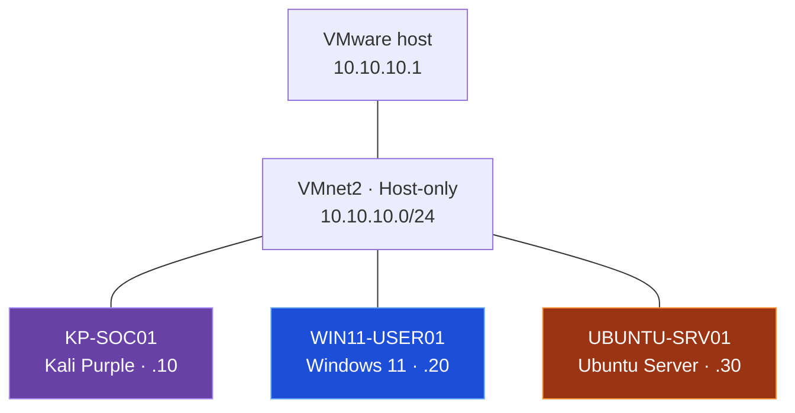
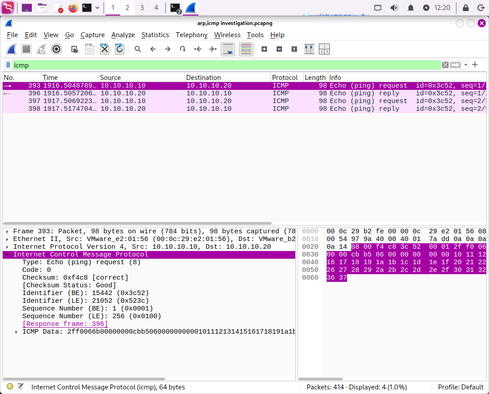
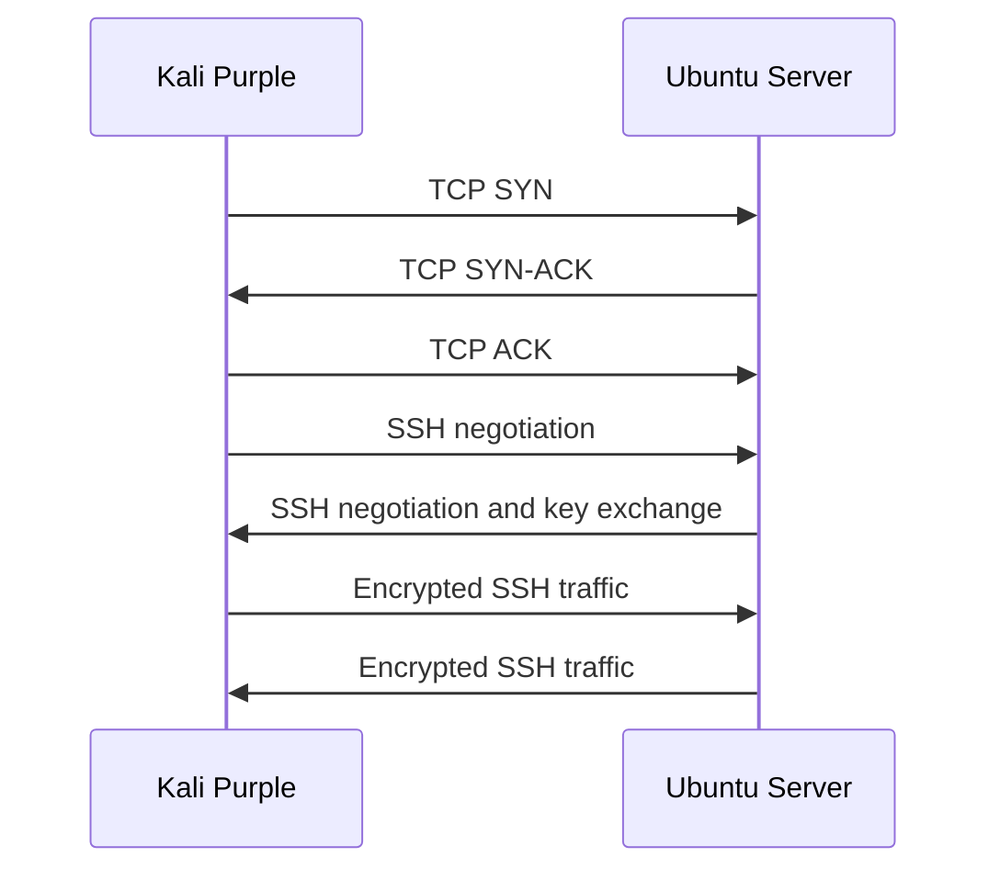

# Project 01 | Core Cyber Range Foundation

**Enterprise Cyber Range / Phase 01 — Foundation**

  

[Overview](#project-overview) · [Architecture](#network-architecture) · [Implementation](#implementation) · [Investigations](#network-traffic-investigation) · [Evidence](#supporting-evidence) · [Main repository](../README.md)

---

## Project Overview

This project establishes the base infrastructure for an enterprise cybersecurity laboratory. It focuses on virtual machine deployment, isolated networking, asset discovery, service baselining, recovery snapshots and packet analysis.

| Virtual machines | Network | Protocol investigations |
| :---: | :---: | :---: |
| **3** | **10.10.10.0/24** | **3** |

### Objectives

- Build a controlled virtual environment with predictable static IP addresses.
- Establish an initial host and service baseline using Nmap.
- Validate communication and investigate network traffic with Wireshark.
- Preserve clean recovery points and document the environment for future projects.

---

## Network Architecture



### Asset inventory

| Hostname | Operating system | IP address | Role |
| :--- | :--- | :--- | :--- |
| KP-SOC01 | Kali Purple | `10.10.10.10` | Security operations workstation |
| WIN11-USER01 | Windows 11 Pro | `10.10.10.20` | Employee endpoint |
| UBUNTU-SRV01 | Ubuntu Server | `10.10.10.30` | Internal Linux server |

### Resource allocation

| System | vCPU | RAM | Virtual disk |
| :--- | ---: | ---: | ---: |
| KP-SOC01 | 4 | 4 GB | 80 GB |
| WIN11-USER01 | 2 | 4 GB | 64 GB |
| UBUNTU-SRV01 | 2 | 2 GB | 40 GB |

### Network configuration

| Parameter | Configuration |
| :--- | :--- |
| Virtual network | VMnet2 |
| Network type | Host-only |
| Subnet | `10.10.10.0/24` |
| Subnet mask | `255.255.255.0` |
| DHCP | Disabled |
| Addressing | Static |
| Default gateway | None |
| Internet access | Disabled during lab testing |

[Full asset inventory](documentation/ASSET-INVENTORY.md) · [Foundation topology](../architecture/FOUNDATION-TOPOLOGY.md)

---

## Implementation

| Milestone | Task | Status |
| :---: | :--- | :--- |
| 01 | Git and GitHub repository setup | Complete |
| 02 | Host readiness and VMware configuration | Complete |
| 03 | Isolated virtual network | Complete |
| 04 | Kali Purple deployment | Complete |
| 05 | Windows 11 deployment | Complete |
| 06 | Ubuntu Server deployment | Complete |
| 07 | Static IP configuration | Complete |
| 08 | Network reconnaissance and baseline | Complete |
| 09 | Clean baseline snapshots | Complete |
| 10 | Asset inventory and documentation | Complete |
| 11 | Wireshark packet investigation | Complete |
| 12 | Evidence collection and project closeout | Complete |

---

## Network Reconnaissance

Nmap was used from KP-SOC01 to establish an initial network asset and service baseline. The following commands can reproduce the discovery and service checks within the authorized lab. The `-n` flag avoids DNS lookups on the isolated network.

```bash
sudo nmap -n -sn 10.10.10.0/24
sudo nmap -n -sS -sV 10.10.10.20
sudo nmap -n -sS -sV 10.10.10.30
```

| Asset | Expected behavior |
| :--- | :--- |
| KP-SOC01 | Security analysis and monitoring |
| WIN11-USER01 | Restricted inbound network access |
| UBUNTU-SRV01 | Authorized SSH service on TCP port 22 |

The baseline provides a reference for investigating unexpected hosts and services in later exercises.

---

## Network Traffic Investigation

### 01 / ARP address resolution

**Objective:** Observe how systems discover MAC addresses on the local Ethernet segment.

**Wireshark display filter:** `arp`

**Findings:** Kali Purple broadcast an ARP request for `10.10.10.20`. The capture shows address resolution exchanges between Kali and Windows, including an ARP reply identifying the Windows MAC address. The initial request has an unknown target MAC address.


*Figure 1. ARP request and response analysis.*

### 02 / ICMP connectivity

**Objective:** Verify communication between the security workstation and employee endpoint.

**Wireshark display filter:** `icmp`

**Findings:** Two ICMP echo requests from `10.10.10.10` and two corresponding echo replies from `10.10.10.20` were observed. The request details show ICMP Type 8. These packets confirm successful connectivity during the test.



*Figure 2. Successful ICMP request/reply validation.*

### 03 / SSH and TCP analysis

**Objective:** Examine the establishment of an encrypted remote administration session between Kali Purple and Ubuntu Server.

**Wireshark display filter:** `tcp.port == 22`



**Findings:** The capture shows the TCP three-way handshake, SSH protocol negotiation, key exchange and encrypted packets between `10.10.10.10` and `10.10.10.30`. The client connects to destination TCP port 22. Encrypted session contents are not readable in the packet capture.


*Figure 3. TCP handshake and SSH session analysis.*

---

## Security Controls

| Control | Implementation |
| :--- | :--- |
| Network isolation | VMware host-only network; no default gateway during testing |
| Endpoint protection | Microsoft Defender enabled |
| Host firewall | Windows Defender Firewall enabled |
| Address management | Static IP addresses |
| Recovery | Clean VMware snapshots |
| Remote administration | SSH encryption |
| Asset visibility | Nmap reconnaissance |
| Network visibility | Wireshark packet analysis |

All three virtual machines have a clean recovery snapshot named `P1-CLEAN-BASELINE`. Snapshots support rollback during later exercises but do not replace independent backups.

---

## Supporting Evidence

| Artifact | Description |
| :--- | :--- |
| [Asset inventory](documentation/ASSET-INVENTORY.md) | Hostnames, network addresses and system roles |
| [Foundation topology](../architecture/FOUNDATION-TOPOLOGY.md) | Network architecture |
| [Host discovery](evidence/host-discovery.txt) | Network asset discovery |
| [Windows service baseline](evidence/windows-baseline.txt) | Endpoint service enumeration |
| [Ubuntu service baseline](evidence/ubuntu-baseline.txt) | Server service enumeration |
| [ARP and ICMP capture](evidence/01-arp-icmp-investigation.pcapng) | Address resolution and connectivity evidence |
| [SSH capture](evidence/02-ssh-investigation.pcapng) | TCP and SSH session evidence |

---

## Technical Skills Demonstrated

  

| Domain | Skills |
| :--- | :--- |
| Virtualization | VM deployment, resource allocation, snapshots |
| Networking | IPv4, subnetting, ARP, ICMP, TCP |
| Linux | System administration, networking, SSH |
| Windows | Endpoint configuration and host security |
| Network security | Reconnaissance and service baselining |
| Security analysis | Packet capture and protocol investigation |
| Documentation | Git, GitHub, architecture diagrams |

## Key Takeaways

Reliable infrastructure and a network baseline are essential before introducing advanced monitoring and detection. This project demonstrated how protocol analysis can validate system behavior and how known services provide context for future investigations. A controlled environment and clean restore points make later security testing repeatable.

---

## Project Outcome

**Status: Complete**

The three-machine foundation is operational. Network connectivity, asset discovery, service baselining and packet investigations establish the starting point for enterprise network segmentation and centralized security monitoring.

**Next:** Project 02 — Enterprise Network Security and Segmentation (pfSense, routing, firewall policy and controlled communication between network zones).

[Return to Enterprise Cyber Range](../README.md)
