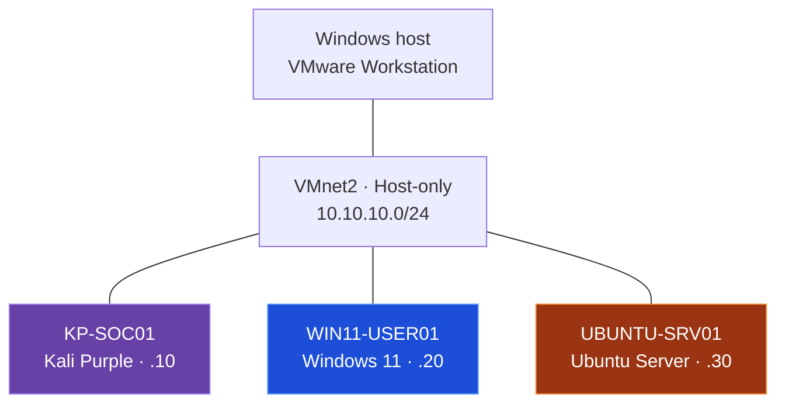
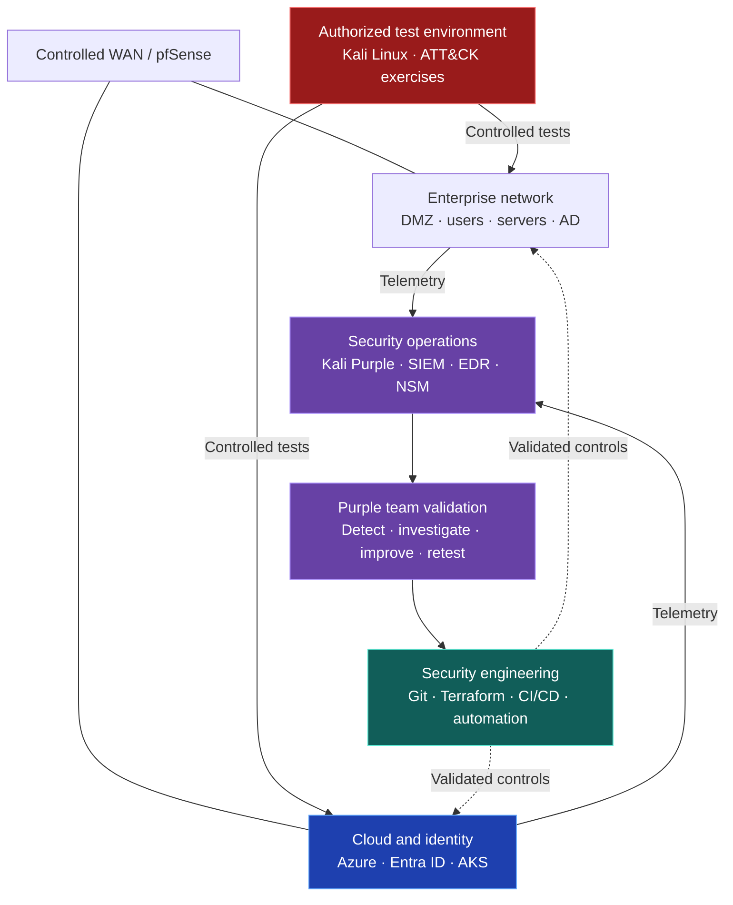

# Enterprise Cyber Range

**Enterprise security engineering · Blue team · Red team · Purple team**

  

A hands-on enterprise cybersecurity environment built progressively to practice infrastructure engineering, security operations, identity security, cloud defense, adversary emulation, and automated security validation.

[Architecture](README.md#range-architecture) · [Roadmap](README.md#range-roadmap) · [Projects](README.md#range-projects) · [Technology](README.md#range-technology)

---

## 01 / Overview

Each project expands the same enterprise environment rather than creating an unrelated lab. The goal is to build, secure, monitor, assess, investigate, and improve the infrastructure through increasingly complex exercises.

| Security domain | Engineering objectives |
| :--- | :--- |
| **Security infrastructure** | Virtualization, network segmentation, system hardening |
| **Blue team** | Security monitoring, threat hunting, incident response |
| **Red team** | Authorized security assessments and adversary emulation |
| **Purple team** | Detection validation and security control improvement |
| **Cloud security** | Azure infrastructure security, cloud logging and detection |
| **Identity security** | Identity lifecycle, access governance, privileged access |
| **Detection engineering** | Develop, test and automate security detections |
| **AppSec / DevSecOps** | Application, container, infrastructure and CI/CD security |

> This cyber range is an independent project. Its future identity environment will be built from scratch, separate from Northstar.

---

## Architecture

### Current environment — deployed

Three virtual machines operate on a host-only network with static IP addresses and no configured default gateway during lab testing. The Windows host adapter is `10.10.10.1`.

[View detailed foundation topology](architecture/FOUNDATION-TOPOLOGY.md) · [View asset inventory](01-foundation/documentation/ASSET-INVENTORY.md)

### Target architecture — planned end state

The following is a **logical architecture**, showing the major security domains and how they will work together. It is not a claim that these systems are already deployed.

---

## Development Roadmap

**Overall progress:** 1 of 100 planned projects complete.

| Phase | Focus | Projects | Status |
| :---: | :--- | :---: | :--- |
| 01 | Core infrastructure and networking | 1–10 | **In progress** |
| 02 | On-premises enterprise security | 11–30 | Planned |
| 03 | Cloud and identity security | 31–50 | Planned |
| 04 | Advanced blue, red and purple team operations | 51–75 | Planned |
| 05 | Enterprise security engineering and automation | 76–100 | Planned |

Difficulty increases from easy to medium, advanced, and hard as the environment develops.

---

## Project Directory

| ID | Project | Category | Difficulty | Status |
| :---: | :--- | :--- | :--- | :--- |
| 01 | [Core Cyber Range Foundation](01-foundation/) | Security infrastructure | Easy–Medium | **Complete** |
| 02 | Enterprise Network Security and Segmentation | Network security | Easy–Medium | Upcoming |

### Featured project — Core Cyber Range Foundation

Deployed three virtual machines, established a static network baseline, configured recovery snapshots, and investigated ARP, ICMP and SSH traffic with Wireshark.

[Read the technical report](01-foundation/README.md) · [Browse supporting evidence](01-foundation/evidence/)

---

## Technology Stack

### Currently deployed and used

     

| Technology | Purpose |
| :--- | :--- |
| VMware Workstation Pro | Virtual infrastructure and recovery snapshots |
| Kali Purple | Security analysis workstation |
| Windows 11 Pro | Simulated enterprise employee endpoint |
| Ubuntu Server | Internal Linux server and SSH administration |
| Nmap | Asset discovery and service enumeration |
| Wireshark | Network traffic capture and analysis |
| Git / GitHub | Version control and technical documentation |

### Planned integrations

| Domain | Technologies |
| :--- | :--- |
| Networking | pfSense, Zeek, Suricata |
| Security operations | Wazuh, Elastic, Sysmon |
| Identity | Active Directory, Microsoft Entra ID, Microsoft Graph |
| Cloud | Azure, Defender for Cloud, Azure Monitor |
| Offensive security | Kali Linux, Burp Suite, BloodHound |
| Purple team | Atomic Red Team, CALDERA, VECTR |
| Detection | Sigma, YARA, KQL, MITRE ATT&CK |
| Automation | Python, PowerShell, Bash, Terraform |
| DevSecOps | GitHub Actions, Docker, Kubernetes |

---

## Project Documentation Standard

Every project documents its scope, architecture, implementation, technical validation, findings, lessons learned and supporting evidence. Completed work is distinguished from future plans.

## Responsible Security Testing

All testing is restricted to personally owned or explicitly authorized laboratory systems. The repository is intended for cybersecurity education, defensive research and professional development. Public evidence must exclude secrets, personal information and unrelated traffic.

---

**Build · Secure · Test · Detect · Respond · Improve**
